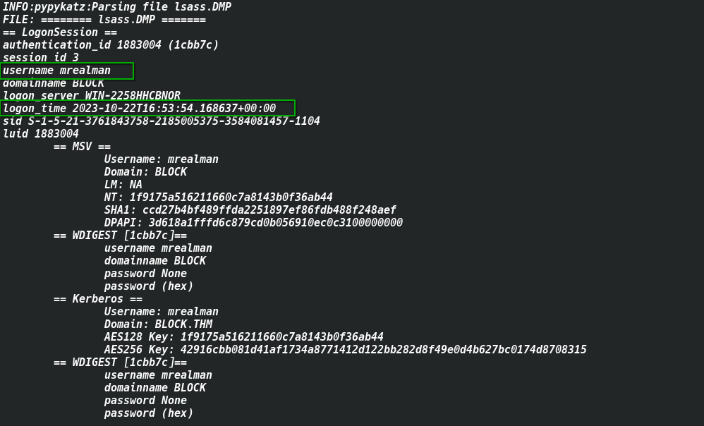
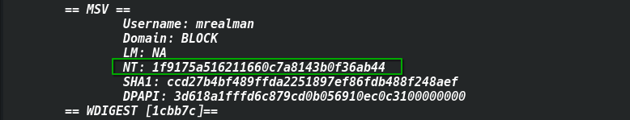
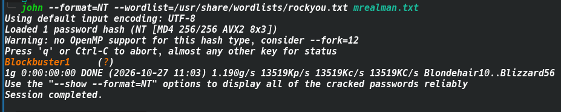
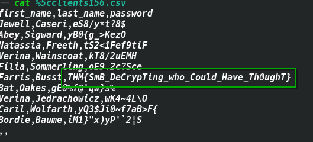
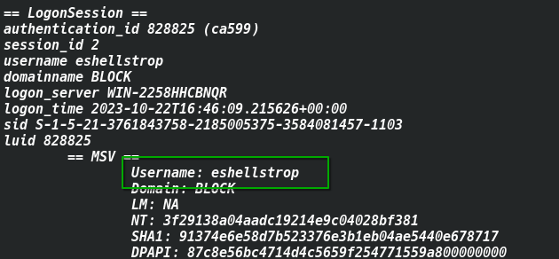
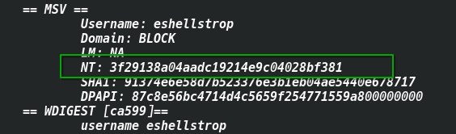

# TryHackMe – Block | Write-up

## Room Overview

A junior system administrator forgot to disable the accounts of two recently terminated employees. Those former employees apparently used their still-active credentials to access private files on the company's file server. Two pieces of evidence were provided for this investigation:

- `lsass.DMP` — a memory dump of the LSASS (Local Security Authority Subsystem Service) process
- `traffic.pcapng` — a network capture of the incident

**Goal:** prove the former employees' unauthorized access by extracting their credentials from the memory dump, then decrypting the SMB3 traffic to recover the files they accessed (which contain the flags).

**Skills covered:** memory forensics, offline hash cracking, NTLM authentication internals, and SMB3 traffic decryption.

---

## Step 1 — Extracting Credentials from the LSASS Dump

`lsass.DMP` contains the authentication secrets of active Windows logon sessions. On Linux, the tool of choice for parsing this is **Pypykatz**, a Python re-implementation of Mimikatz.

```bash
pip3 install pypykatz
pypykatz lsa minidump lsass.DMP
```



The dump reveals two sessions of interest.

**User 1:**
- Username: `mrealman`
- Domain: `BLOCK`
- NT hash: `1f9175a516211660c7a8143b0f36ab44`
- Cleartext password: not recoverable directly (WDigest is disabled on the host)

**User 2:**
- Username: `eshellstrop`
- NT hash: `3f29138a04aadc19214e9c04028bf381`

---

## Step 2 — Cracking `mrealman`'s Password

Since only the NTLM hash was recoverable for `mrealman`, the next step is an offline crack.

Save the hash to a file:

```bash
echo '1f9175a516211660c7a8143b0f36ab44' > mrealman.txt
```

Crack it with **John the Ripper** against `rockyou.txt`:

```bash
john --format=NT --wordlist=/usr/share/wordlists/rockyou.txt mrealman.txt
```

```
Using default input encoding: UTF-8
Loaded 1 password hash (NT [MD4 256/256 AVX2 8x3])
Blockbuster1     (?)
1g 0:00:00:00 DONE (2026-10-27 11:03) 1.190g/s 13519Kp/s 13519Kc/s 13519KC/s Blondehair10..Blizzard56
```

**Password recovered:** `Blockbuster1`

> Equivalent with Hashcat: `hashcat -m 1000 mrealman.txt /usr/share/wordlists/rockyou.txt`



---

## Step 3 — Extracting NTLM Parameters from the PCAP

The captured traffic uses **SMB3**, which encrypts its payload. To decrypt it, the NTLM authentication handshake must be parsed out of the capture to derive the session key.

Open `traffic.pcapng` in Wireshark and filter on `ntlmssp`:

```bash
wireshark traffic.pcapng &
```

Locate the `Session Setup Request` / `NTLMSSP_AUTH` packet for `WORKGROUP\mrealman` (packet #11 in this capture) and pull out the following fields:

| Field | Value |
|---|---|
| Session ID | `0x0000100000000041` |
| NTProofStr | `16e816dead16d4ca7d5d6dee4a015c14` |
| Encrypted Session Key | `fde53b54cb676b9bbf0fb1fbef384698` |



---

## Step 4 — Deriving the Random Session Key

SMB3 does not decrypt with the Encrypted Session Key directly — it needs the **Random Session Key**, derived from the NT hash, username, domain, the NTProofStr, and the encrypted session key.

Using [`randomSessionKeyNTLM.py`](https://github.com) (a small NTLMv2 key-derivation helper):

```bash
python3 randomSessionKeyNTLM.py \
  -u mrealman \
  -d WORKGROUP \
  -n 1f9175a516211660c7a8143b0f36ab44 \
  -p 16e816dead16d4ca7d5d6dee4a015c14 \
  -k fde53b54cb676b9bbf0fb1fbef384698
```

**Result:**
```
Random SK: 20a642c086ef74eee26277bf1d0cff8c
```

---

## Step 5 — Decrypting SMB3 and Recovering the First Flag

In Wireshark: `Edit > Preferences > Protocols > SMB2 > Secret session key to use for decryption > Edit`.

Add a new mapping. Note that the Session ID must be entered in **reversed byte order** relative to how it appears in the packet:

| Field | Value |
|---|---|
| Session ID | `4100000000100000` |
| Session Key | `20a642c086ef74eee26277bf1d0cff8c` |

Click OK — the SMB3 traffic decrypts in place.



Go to `File > Export Objects > SMB` to list the files transferred in the session, then export the CSV (`%5cclients156.csv`) and inspect it:

**Flag 1:** `THM{SmB_DeCrypTing_who_Could_Have_Th0ughT}`



---

## Step 6 — Repeating the Process for the Second User

`eshellstrop` left the same trail in the capture.

**1. NT hash** (already obtained in Step 1):
```
3f29138a04aadc19214e9c04028bf381
```

**2. NTLM parameters from the PCAP** (packet #82):

| Field | Value |
|---|---|
| Session ID | `0x0000100000000045` → reversed: `4500000000100000` |
| NTProofStr | `0ca6227a4f00b9654a48908c4801a0ac` |
| Encrypted Session Key | `c24f5102a22d286336aac2dfa4dc2e04` |

**3. Derive the Random Session Key:**

```bash
python3 randomSessionKeyNTLM.py \
  -u eshellstrop \
  -d WORKGROUP \
  -n 3f29138a04aadc19214e9c04028bf381 \
  -p 0ca6227a4f00b9654a48908c4801a0ac \
  -k c24f5102a22d286336aac2dfa4dc2e04
```

**4. Add the new key to Wireshark** (Session ID `4500000000100000`), re-export SMB objects, and read the second CSV:


**Flag 2:** `THM{No_PasSw0Rd?_No_Pr0bl3m}`



---

## Summary

| Question | Answer |
|---|---|
| First user's username | `mrealman` |
| First user's password | `Blockbuster1` |
| First flag | `THM{SmB_DeCrypTing_who_Could_Have_Th0ughT}` |
| Second user's username | `eshellstrop` |
| Second user's NT hash | `3f29138a04aadc19214e9c04028bf381` |
| Second flag | `THM{No_PasSw0Rd?_No_Pr0bl3m}` |

---

## Key Takeaways

- **Memory forensics:** `pypykatz` can extract cached authentication secrets from an LSASS dump on Linux without needing a live Windows host or Mimikatz itself.
- **Offline hash cracking:** an NT hash with no WDigest-cached plaintext is still crackable offline with `john`/`hashcat` against a wordlist like `rockyou.txt` when the password is weak.
- **NTLM/SMB3 internals:** SMB3 traffic isn't decrypted with the raw NTLM session key — it requires deriving a *Random Session Key* from the NTProofStr, encrypted session key, and the NT hash.
- **Traffic decryption:** once the correct session key is mapped to the right Session ID (careful with Wireshark's reversed byte order) in Wireshark's SMB2 protocol preferences, encrypted SMB3 captures become fully readable, including exported file objects.
- **Operational lesson:** this scenario is a clean illustration of why credential rotation and immediate account deactivation at offboarding matter — and how combining memory forensics with network forensics can reconstruct exactly what an attacker (or in this case, a disgruntled ex-employee) did.

---

*Write-up by SubZer030 | TryHackMe: Block*