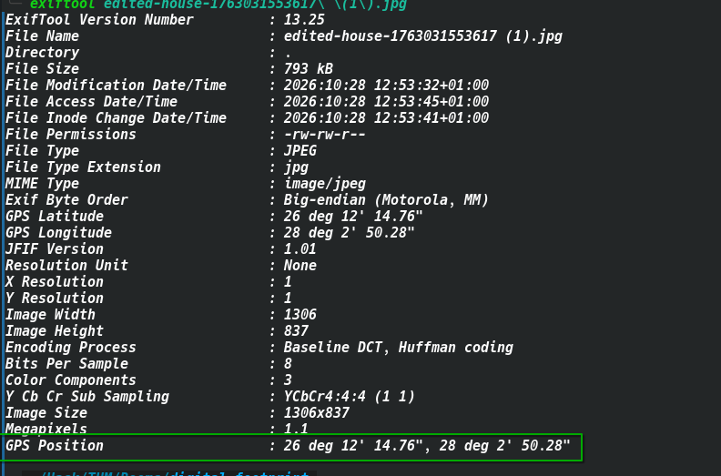
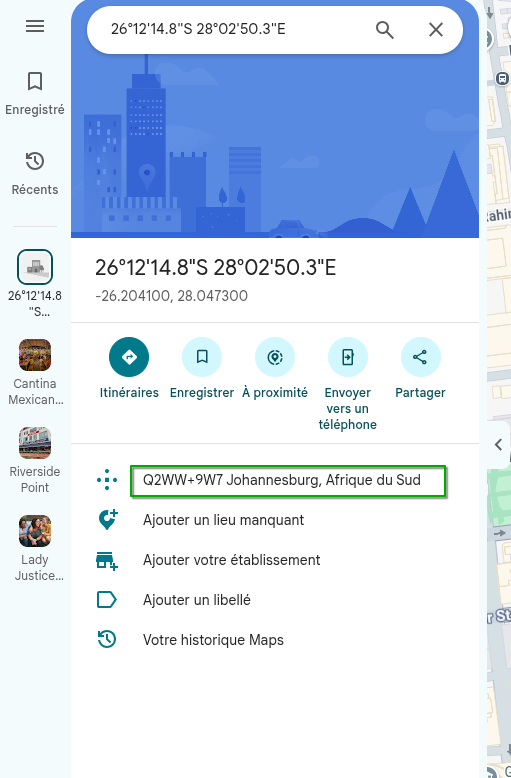
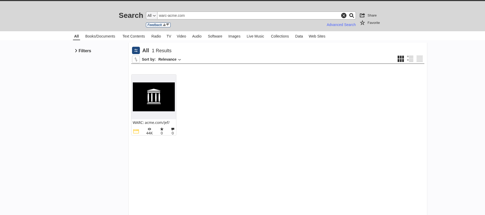
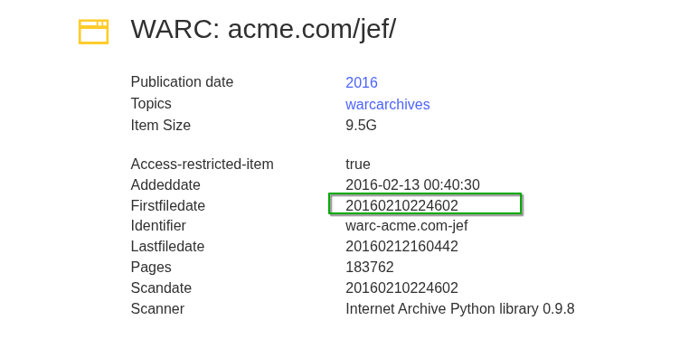
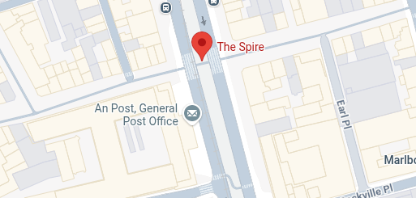
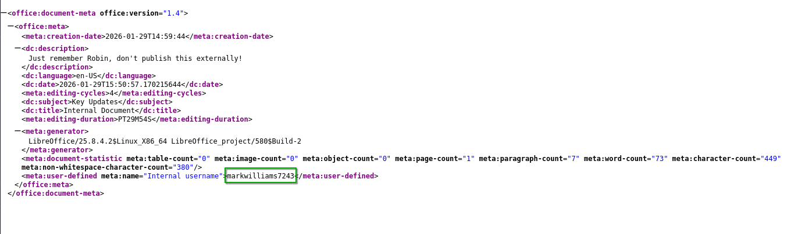
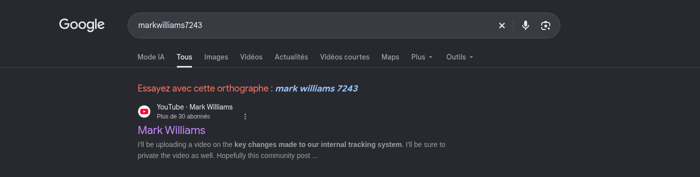
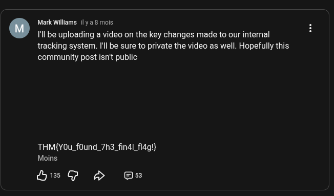

# TryHackMe — ACME Jet Solutions OSINT Challenge Write-Up

> **Category:** OSINT  
> **Difficulty:** Easy / Medium  
> **All flags found ✅**

---

## Table of Contents

1. [Task 1 — The Leaked Photo](#task-1--the-leaked-photo)
2. [Task 2 — Archived Company Website](#task-2--archived-company-website)
3. [Task 3 — Mysterious Landmark](#task-3--mysterious-landmark)
4. [Task 4 — Internal Documents](#task-4--internal-documents)

---

## Task 1 — The Leaked Photo

### Challenge Description

> An ACME Jet Solutions employee uploaded a photo of a residential property believed to be linked to ACME Jet's early operations. Can you figure out where the picture was taken to confirm or debunk the rumour?

**Flag format:** `THM{CityName}`

---

### Approach

The first step was to analyse the image metadata using **ExifTool**, a standard tool for reading EXIF data embedded in image files.

```bash
exiftool task_1.png
```

The output revealed **GPS coordinates** embedded in the photo's metadata.



Those coordinates were then pasted directly into **Google Maps**, which pinpointed the location to a residential area in **Johannesburg, South Africa**.



### Flag

```
THM{Johannesburg}
```

---

## Task 2 — Archived Company Website

### Challenge Description

> ACME Jet Solutions (`warc-acme.com/jef/`) claims they were founded in 2025. But an ex-employee insists the company existed long before that. Verify their true founding date using only public information.

**Flag format:** `THM{20160210224602}` *(timestamp)*

---

### Approach

The goal here was to find the **first archived snapshot** of the company's website. The natural tool for this is the **Wayback Machine** (web.archive.org).

1. Navigate to [https://web.archive.org](https://web.archive.org)
2. Enter the URL: `warc-acme.com/jef/`
3. Browse the calendar to find the **earliest available snapshot**



The earliest capture timestamp found was **`20160210224602`**, which translates to:
- **Date:** February 10, 2016
- **Time:** 22:46:02 UTC

This confirmed the company existed well before their claimed 2025 founding date.



### Flag

```
THM{20160210224602}
```

---

## Task 3 — Mysterious Landmark

### Challenge Description

> Further investigation uncovers another image believed to be connected to the company's international expansion. Research reveals that to the right of the iconic landmark is a building that played a big role in the fight for independence of a particular country. Signs on the external wall provide the name of the building.
>
> Submit the name of the building **translated into English** as the flag.

**Flag format:** `THM{Building Name}`

---

### Approach

A **reverse image search** (Google Lens / Google Images) was performed on the provided photo.

```
Right-click image → Search image with Google
```

The search immediately identified the iconic landmark as **The Spire of Dublin** (also known as *Monument of Light*), located on O'Connell Street, Dublin, Ireland.



With the landmark confirmed, the next step was to identify the building **to the right of The Spire** on O'Connell Street. Cross-referencing street-view imagery and historical records, the building on the right is the **General Post Office (GPO)** — a landmark of immense historical significance as the headquarters of the 1916 Easter Rising, a pivotal moment in Ireland's fight for independence.

The name visible on the building's external wall in Irish is **"An Phríomh-Oifig Poist"**, which translates to **General Post Office**.

### Flag

```
THM{General Post Office}
```

---

## Task 4 — Internal Documents

### Challenge Description

> An internal document was accidentally leaked by one of the company's developers. The document may contain crucial information about the individual responsible for maintaining their systems.

---

### Approach

The leaked document was an **`.odt` file** (OpenDocument Text). Since `.odt` files are ZIP archives under the hood, they can be extracted directly with `7z`:

```bash
7z x internal-docs-1769695301727.odt
```

**Output:**

```
Scanning the drive for archives:
1 file, 14808 bytes (15 KiB)

Extracting archive: internal-docs-1769695301727.odt
--
Path = internal-docs-1769695301727.odt
Type = zip
Physical Size = 14808

Everything is Ok

Folders: 1
Files: 8
Size:       44446
Compressed: 14808
```

This extracted 8 files. The interesting one is **`meta.xml`**, which stores document metadata including author information.

```bash
cat meta.xml
```



The `meta.xml` file contained a **username** embedded in the document metadata (e.g. in the `<meta:initial-creator>` or `<dc:creator>` field).

That username was then searched on **Google**, which led to a **YouTube channel/page** belonging to the developer.



Navigating to the YouTube page revealed the **final flag** in the channel description or a pinned post.



### Flag

```
THM{Y0u_f0und_7h3_fin4l_fl4g!}
```

---

## Summary

| Task | Description | Method | Flag |
|------|-------------|--------|------|
| 1 | Leaked Photo | ExifTool → GPS → Google Maps | `THM{Johannesburg}` |
| 2 | Archived Website | Wayback Machine first snapshot | `THM{20160210224602}` |
| 3 | Mysterious Landmark | Reverse image search → street research | `THM{General Post Office}` |
| 4 | Internal Documents | 7z extract → meta.xml → username → YouTube | `THM{Y0u_f0und_7h3_fin4l_fl4g!}` |

---

## Tools Used

| Tool | Purpose |
|------|---------|
| `exiftool` | Extract EXIF/GPS metadata from images |
| Google Maps | Geolocate GPS coordinates |
| Wayback Machine (web.archive.org) | Find archived website snapshots |
| Google Reverse Image Search / Google Lens | Identify landmarks from photos |
| `7z` | Extract contents of `.odt` (ZIP) archive |
| `cat` | Read `meta.xml` from extracted archive |
| Google Search | OSINT lookup of recovered username |

---

*Write-up by SubZer030— TryHackMe OSINT Challenge*