# TryHackMe — REvil Corp Write-Up

## Scenario

## Tools Used

## Task 1 — Compromised Employee Full Name

## Task 2 — Operating System

## Task 3 and 4 — Malicious Executable and Download URL

## Task 5 — MD5 Hash of the Binary

## Task 6 — Size of the Binary

## Task 7 — Ransomware File Extension

## Task 8 — Number of Files Renamed

## Task 9 — Wallpaper Changed by Attacker

## Task 10 — Ransom Note Name

## Task 11 — File in Links for United States Folder

## Task 12 — Hidden File on the Desktop

## Task 13 — MD5 Hash of the Decryptor

## Task 14 — Decryptor URL from Ransom Note

## Task 15 — Three Malware Names

## Conclusion

## Scenario

One of the employees at **Lockman Group** called the IT department in a panic — all of his files had been renamed to a bizarre extension he had never seen before. The IT team quickly recognized the signs of a ransomware infection and escalated the case to the **Incident Response** team.

As the incident responder, your mission is to investigate the compromised workstation using **Mandiant Redline**, a powerful memory and file forensic tool, to reconstruct exactly what happened, how the attacker got in, and what damage was done.

> **Platform:** TryHackMe — *REvil Corp* **Category:** Digital Forensics & Incident Response (DFIR) **Tool:** Mandiant Redline **Difficulty:** Medium

## Tools Used

- **Mandiant Redline** — Host-based investigative tool for memory and file analysis, process inspection, browser history, timeline reconstruction, and IOC scanning.
- **VirusTotal** — Online multi-engine malware scanning platform used to look up file hashes and identify malware families.

## Task 1 — Compromised Employee Full Name

**Answer: `John Coleman`**

### How to find it

Open the Mandiant Analysis file and navigate to **Home → Host → System Information** in the left panel.

Scroll down to the **User Information** section at the bottom of the page. The field **Logged in User** reveals the name of the active session user at the time the snapshot was taken.

```
Logged in User:  John Coleman
Logged on User:  WIN-HKKQB6M7FTQ\John Coleman, WORKGROUP\WIN-HKKQB6M7FTQ$
```

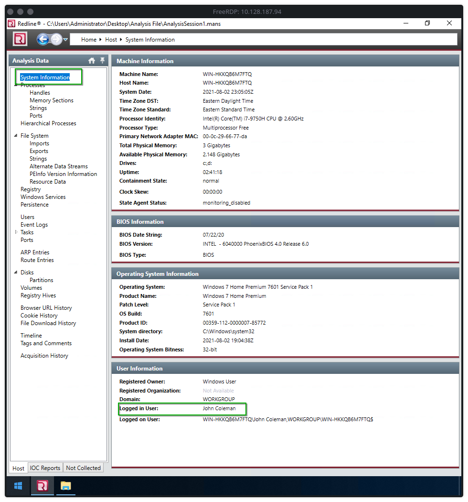

## Task 2 — Operating System

**Answer: `Windows 7 Home Premium 7601 Service Pack 1`**

### How to find it

Still on the **System Information** page, look at the **Operating System Information** section.

```
Operating System:  Windows 7 Home Premium 7601 Service Pack 1
Product Name:      Windows 7 Home Premium
Patch Level:       Service Pack 1
OS Build:          7601
Operating System Bitness: 32-bit
```

This tells us the host was running a **32-bit Windows 7** machine — an outdated OS with a well-known attack surface, which explains why it became an easy target.

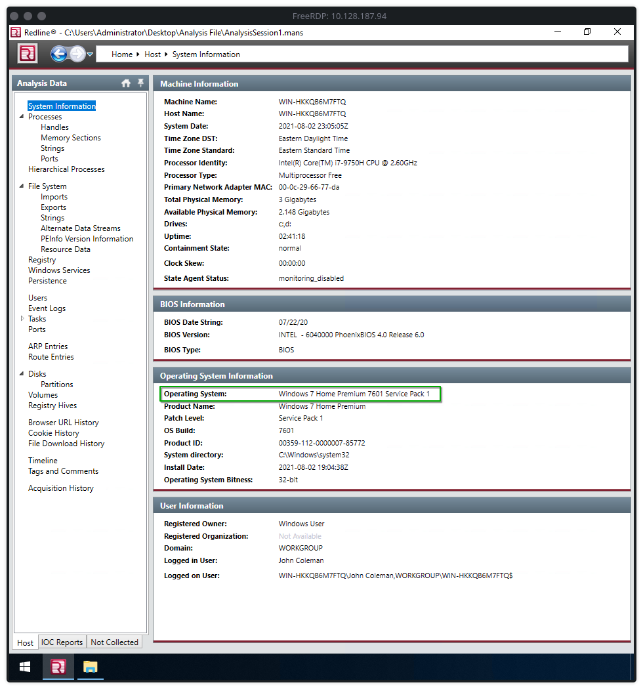

## Task 3 and 4 — Malicious Executable and Download URL

**Answer (Task 3 — Executable name): `WinRAR2021.exe`**

**Answer (Task 4 — Full URL): `http://192.168.75.129:4748/Documents/WinRAR2021.exe`**

### How to find it

Navigate to **Home → Host → File Download History** in the left panel. Inspect the entries — one stands out immediately:

```
Type:             Auto
Source URL:       http://192.168.75.129:4748/Documents/WinRAR2021.exe
Target Directory: C:\Users\John Coleman\Downloads\WinRAR2021.exe
Filename:         WinRAR2021.exe
File Size:        164 Kilobytes
Browser:          Internet Explorer 11.0.9600.19100
Username:         John Coleman
```

The file was downloaded from a **local network server** (192.168.75.129) running on a non-standard port (4748), posing as a legitimate WinRAR installer. This is a classic **social engineering / masquerading** technique used by ransomware operators.

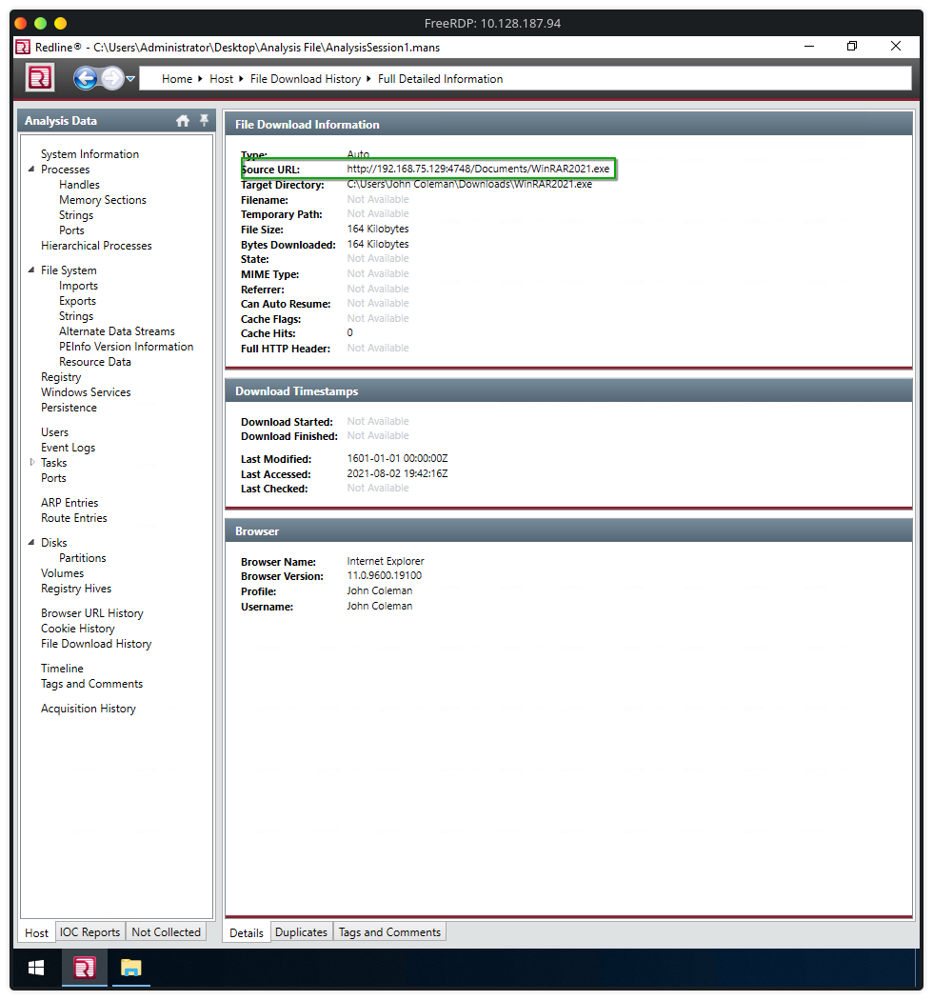

## Task 5 — MD5 Hash of the Binary

**Answer: `890a58f200dfff23165df9e1b088e58f`**

### How to find it

Navigate to **Home → Host → File System** and browse to `C:\Users\John Coleman\Downloads\`. Select `WinRAR2021.exe`. On the right-hand **Selected Item Details** panel, scroll to **File Hashes**:

```
MD5:  890a58f200dfff23165df9e1b088e58f
```

This hash can then be cross-referenced on **VirusTotal** to confirm malicious activity and identify the malware family.

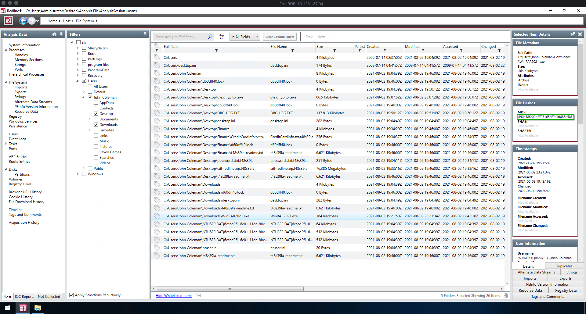

## Task 6 — Size of the Binary

**Answer: `164 Kilobytes`**

### How to find it

With `WinRAR2021.exe` still selected in **File System**, the **Selected Item Details** panel on the right shows:

```
Full Path:  C:\Users\John Coleman\Downloads\WinRAR2021.exe
Size:       164 Kilobytes
Attributes: Archive
```

The file size of 164 KB is suspiciously small for a legitimate WinRAR installer, which is typically several megabytes — a strong indicator that the binary is malicious.

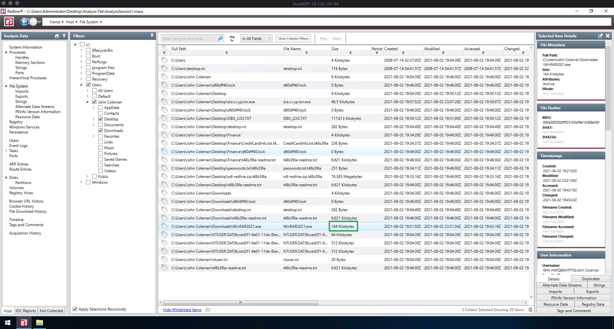

## Task 7 — Ransomware File Extension

**Answer: `.t48s39la`**

### How to find it

Navigate to **Home → Host → File System** and search for any encrypted files. You can spot renamed files throughout the user's directories — they all share the same appended extension.

For example, in `C:\Users\John Coleman\Desktop\Finance\`:

```
CreditCardInfo.txt.t48s39la
passwords.txt.t48s39la
t48s39la-readme.txt
```

The extension **`.t48s39la`** is a random alphanumeric string generated per victim by REvil — it is unique to this specific infection and replaces the original file extension entirely.

You can also confirm it in the ransom note filename: `t48s39la-readme.txt`.

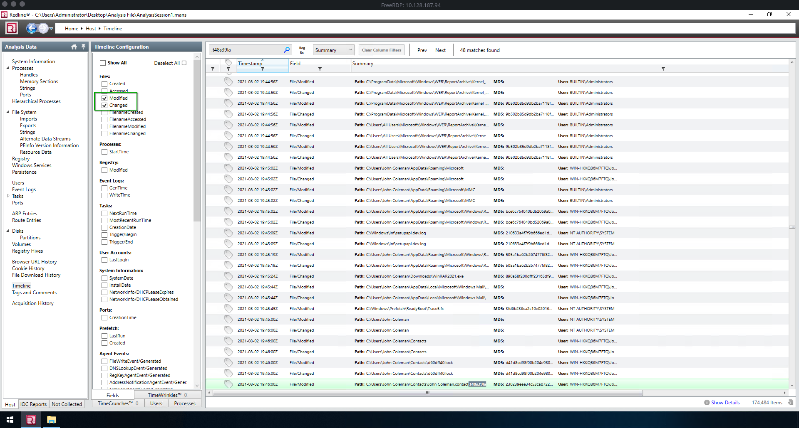


## Task 8 — Number of Files Renamed

**Answer: `48`**

### How to find it

Navigate to **Home → Host → Timeline**. In the **Timeline Configuration** panel on the left:

1. Click **Deselect All** to clear all checkboxes.
2. Under **Files**, check only **Modified** and **Changed**.
3. In the search box at the top, enter: `t48s39la`

Redline will display all timeline events matching that extension. The counter in the top-right corner reads:

```
48 matches found
```

This means **48 files** were renamed and had their extensions changed to `.t48s39la` by the ransomware during the encryption process.

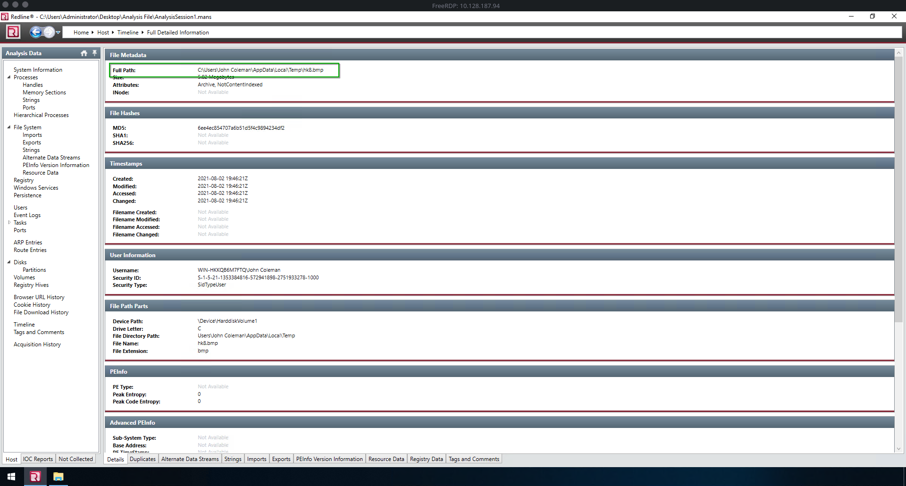

## Task 9 — Wallpaper Changed by Attacker

**Answer: `C:\Users\John Coleman\AppData\Local\Temp\hk8.bmp`**

### How to find it

REvil ransomware changes the desktop wallpaper to display its ransom message. To find it:

1. Go to **Home → Host → Timeline**.
2. Filter by **Files: Modified / Changed**.
3. Search for `.bmp` in the search box, or scroll through the timeline events shortly after the ransomware execution timestamp (around `2021-08-02 19:46:00Z`).

Looking at the full detailed information of the wallpaper file:

```
Full Path:           C:\Users\John Coleman\AppData\Local\Temp\hk8.bmp
MD5:                 6ee4ec854707a6b51d5f4c9894234df2
Created:             2021-08-02 19:46:21Z
File Directory Path: Users\John Coleman\AppData\Local\Temp
File Name:           hk8.bmp
File Extension:      bmp
```

The `.bmp` file was dropped into the user's **Temp** folder by the ransomware and then set as the desktop wallpaper — a common REvil behavior to intimidate the victim.

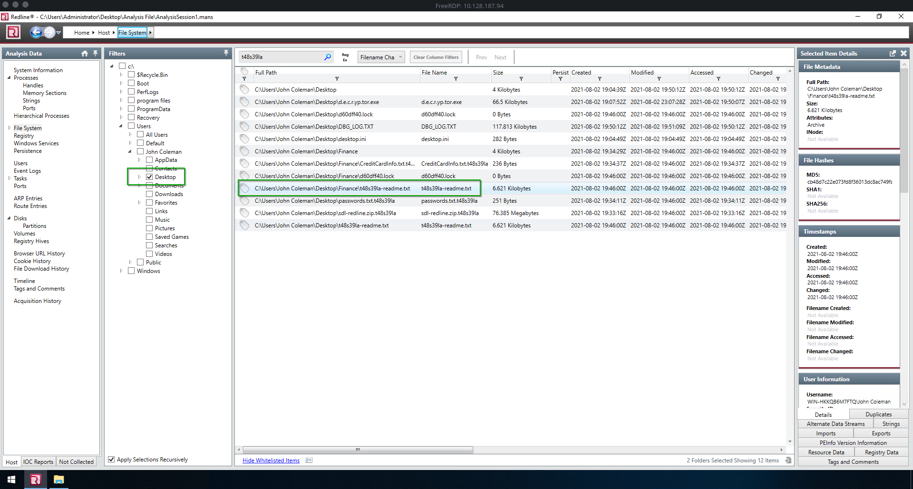
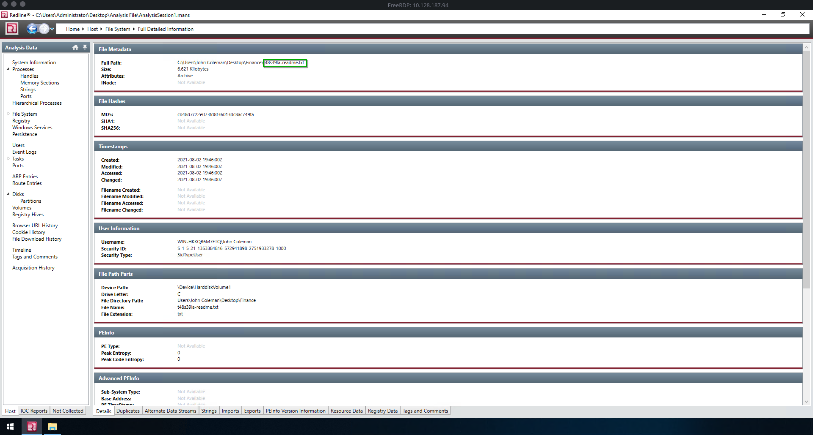

## Task 10 — Ransom Note Name

**Answer: `t48s39la-readme.txt`**

### How to find it

Navigate to **Home → Host → File System** and filter on the **Desktop** folder (`C:\Users\John Coleman\Desktop\`). You'll notice a text file that doesn't match the victim's naming conventions:

```
C:\Users\John Coleman\Desktop\t48s39la-readme.txt
```

REvil drops a ransom note in **every directory it encrypts**, always named in the pattern `<victim-extension>-readme.txt`. The note contains:

- A unique victim ID
- Instructions to visit a Tor-based site
- A direct URL (accessible without Tor) to decrypt one file for free
- Contact details for the attacker

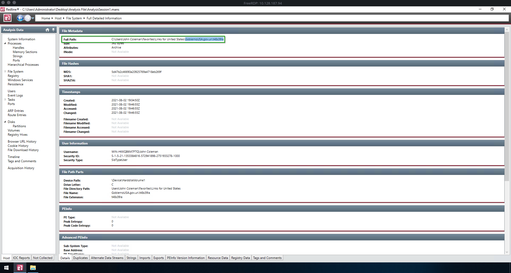 (file visible in Desktop listing)

## Task 11 — File Left in "Links for United States" Folder

**Answer: `GobiernoUSA.gov.url.t48s39la`**

### How to find it

Navigate to **Home → Host → File System** and browse to:

```
C:\Users\John Coleman\Favorites\Links for United States\
```

Search for `t48s39la` in the File System search box and filter to show results in this folder. You will find a file whose original name was a browser shortcut (`.url`) that was encrypted and renamed:

```
Full Path:   C:\Users\John Coleman\Favorites\Links for United States\GobiernoUSA.gov.url.t48s39la
Size:        362 Bytes
MD5:         5d47b2c46690a20925769a4718eb269f
File Extension: t48s39la
```

This was originally a browser favorites link to `GobiernoUSA.gov` — an official US government portal. The ransomware encrypted everything it could find, including harmless browser shortcuts.

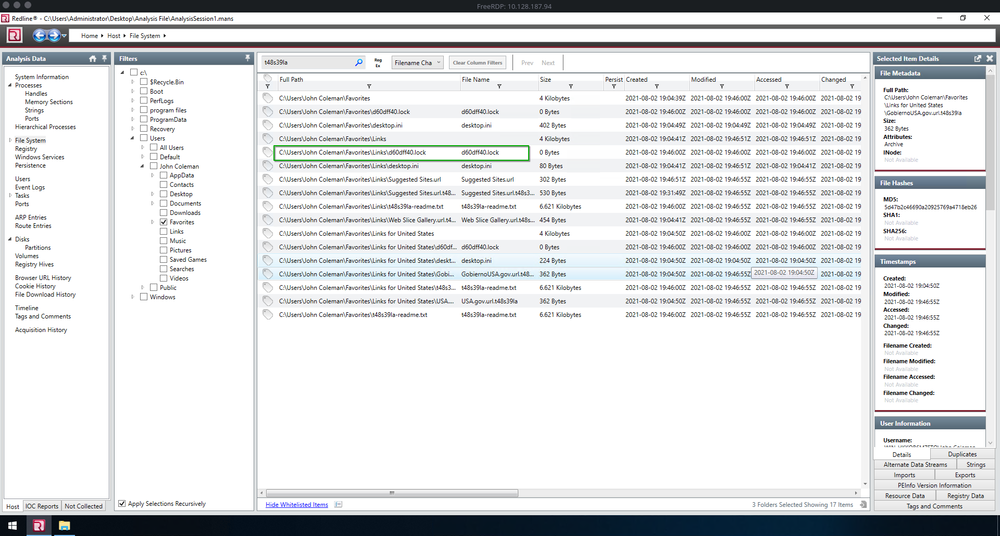

## Task 12 — Hidden File on the Desktop

**Answer: `d60dff40.lock`**

### How to find it

In **Home → Host → File System**, navigate to `C:\Users\John Coleman\Desktop\` and look for files with **0 bytes** in size and the **Hidden** attribute set. You'll notice:

```
Full Path:  C:\Users\John Coleman\Desktop\d60dff40.lock
Size:       0 Bytes
Attributes: Hidden
```

This `.lock` file is a **mutex / semaphore file** commonly dropped by ransomware to:

- Signal to other instances of the ransomware that encryption is already in progress (prevents double-encryption)
- Mark the system as already infected

The file is hidden so the victim won't notice it. Its presence across multiple directories (`Downloads`, `Desktop`, `Contacts`, etc.) confirms the ransomware's thoroughness.

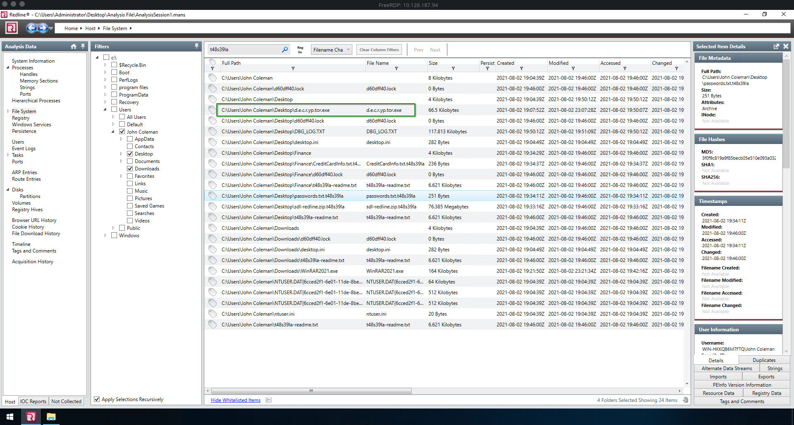
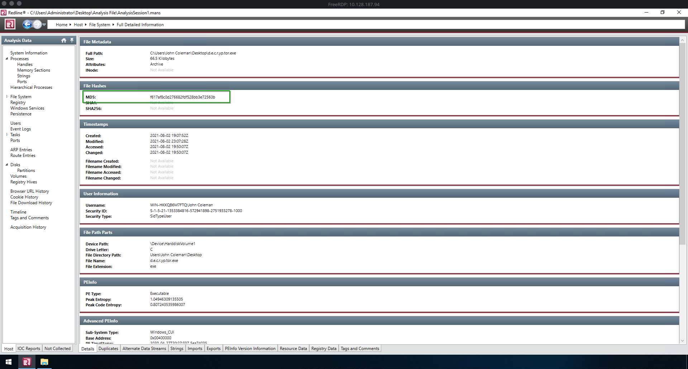

## Task 13 — MD5 Hash of the Decryptor

**Answer: `f617af8c0d276682fef528bb3e72560b`**

### How to find it

After the infection, the desperate user attempted to download a decryptor tool. Navigate to **Home → Host → File System** and look in `C:\Users\John Coleman\Desktop\` for an executable file that is not the ransomware itself.

You'll find `d.e.c.r.yp.tor.exe`:

```
Full Path:  C:\Users\John Coleman\Desktop\d.e.c.r.yp.tor.exe
Size:       66.5 Kilobytes
MD5:        f617af8c0d276682fef528bb3e72560b
Created:    2021-08-02 19:07:52Z
Modified:   2021-08-02 23:07:28Z
PE Type:    Executable
```

This file was downloaded from the decryptor portal provided in the ransom note. Unfortunately, the decryptor did not work — a common outcome when victims attempt to use unverified decryptors.

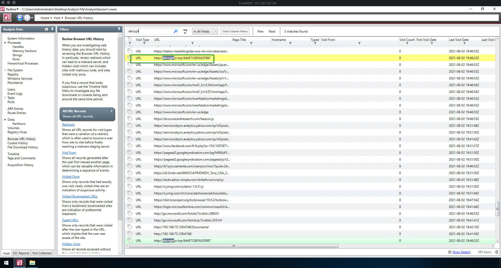

## Task 14 — Decryptor URL from Ransom Note

**Answer: `http://decryptor.top/644E7C8EFA02FBB7`**

### How to find it

Navigate to **Home → Host → Browser URL History**. In the search bar at the top, type:

```
decrypt
```

Redline filters all browsing history to entries matching that keyword. Among the results you'll see:

```
Visit Type:       URL
URL:              http://decryptor.top/644E7C8EFA02FBB7
Last Visit Date:  2021-08-02 19:48:23Z
```

The URL `http://decryptor.top/644E7C8EFA02FBB7` is the **clearnet (non-Tor)** decryption portal that REvil provided in the ransom note. The path `644E7C8EFA02FBB7` is the **victim's unique ID**. This allowed the attacker to offer one free file decryption as a trust-building measure.

This URL also appears duplicated at the bottom of the results list, confirming the user visited it multiple times.

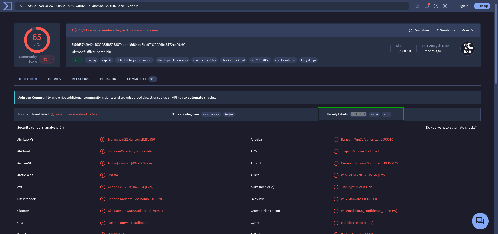

## Task 15 — Three Malware Names

**Answer: `REvil, Sodin, Sodinokibi`** (alphabetical order)

### How to find it

Take the MD5 hash of `WinRAR2021.exe` (`890a58f200dfff23165df9e1b088e58f`) and search for it on **VirusTotal** (https://www.virustotal.com).

On the detection page, look at the **Family labels** section in the top summary bar (next to "Popular threat label" and "Threat categories"):

```
Popular threat label:  ransomware.sodinokibi/sodin
Threat categories:     ransomware, trojan
Family labels:         sodinokibi   sodin   expl
```

Cross-referencing with the vendor detections (AliCloud, ALYac, BitDefender, ClamAV, CTX, etc.), you'll also see references to **REvil** — the name of the Ransomware-as-a-Service (RaaS) operation that operates this malware.

The three names, in alphabetical order:

| Name | Description |
| --- | --- |
| **REvil** | The threat actor group / RaaS operation name |
| **Sodin** | Short alias for the malware |
| **Sodinokibi** | Full technical name of the ransomware family |


## Conclusion

This investigation demonstrates a full ransomware attack lifecycle against a corporate endpoint:

1. **Initial Access** — The attacker hosted a fake `WinRAR2021.exe` on an internal server (192.168.75.129:4748) and tricked the user into downloading and executing it via Internet Explorer.
2. **Execution** — The binary (`890a58f200dfff23165df9e1b088e58f`) was executed from `C:\Users\John Coleman\Downloads\`, triggering the Sodinokibi / REvil ransomware.
3. **Impact** — The ransomware encrypted **48 files**, appending the unique victim extension `.t48s39la`, dropped ransom notes in every directory, changed the desktop wallpaper to `hk8.bmp`, and created hidden lock files to prevent re-infection.
4. **Attacker Communication** — The ransom note pointed the victim to `http://decryptor.top/644E7C8EFA02FBB7` for a free single-file decryption as proof of capability.
5. **Victim Response** — John Coleman visited the decryptor URL and downloaded `d.e.c.r.yp.tor.exe` (`f617af8c0d276682fef528bb3e72560b`), but the decryptor failed.

### Key Indicators of Compromise (IOCs)

| IOC | Value |
| --- | --- |
| Malicious binary | `WinRAR2021.exe` |
| Download URL | `http://192.168.75.129:4748/Documents/WinRAR2021.exe` |
| Binary MD5 | `890a58f200dfff23165df9e1b088e58f` |
| Ransomware extension | `.t48s39la` |
| Wallpaper | `C:\Users\John Coleman\AppData\Local\Temp\hk8.bmp` |
| Lock file | `d60dff40.lock` |
| Decryptor MD5 | `f617af8c0d276682fef528bb3e72560b` |
| C2 / Decryptor URL | `http://decryptor.top/644E7C8EFA02FBB7` |
| Malware family | REvil / Sodinokibi / Sodin |

*Writeup by SubZer030 — TryHackMe: Revil Corp*